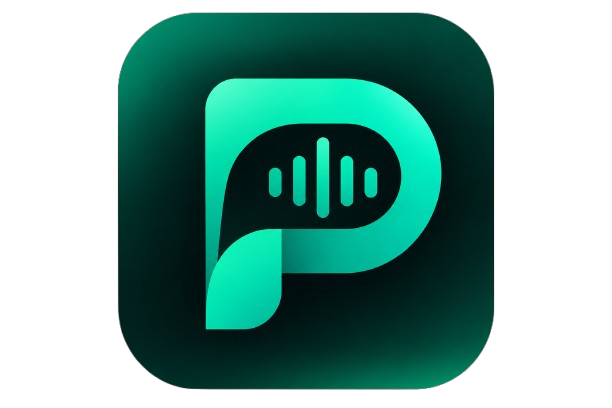
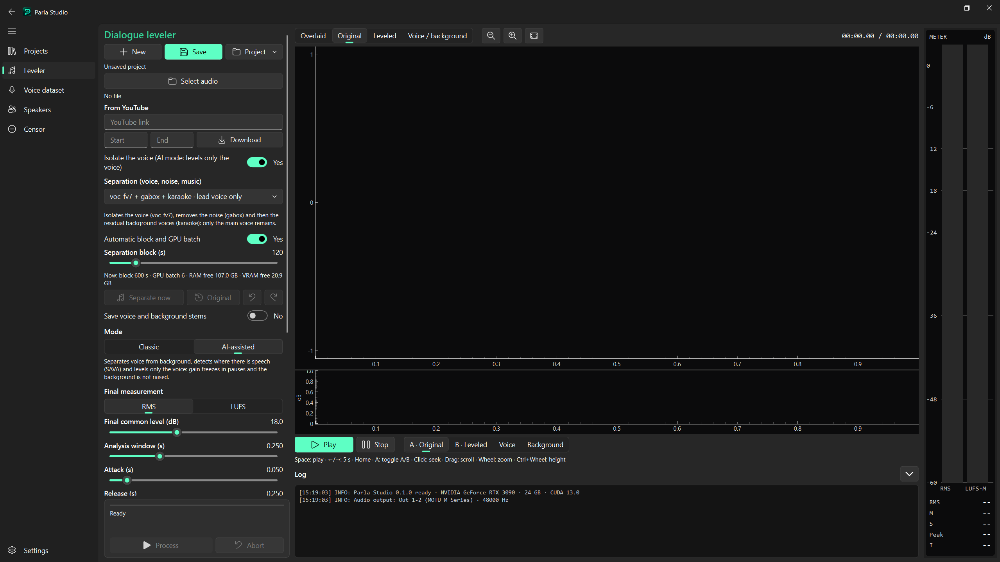
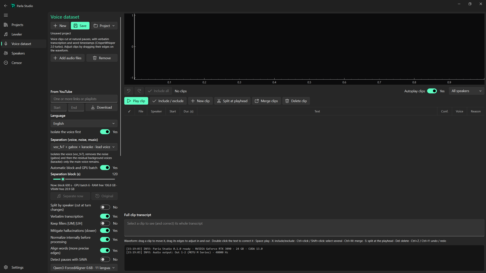
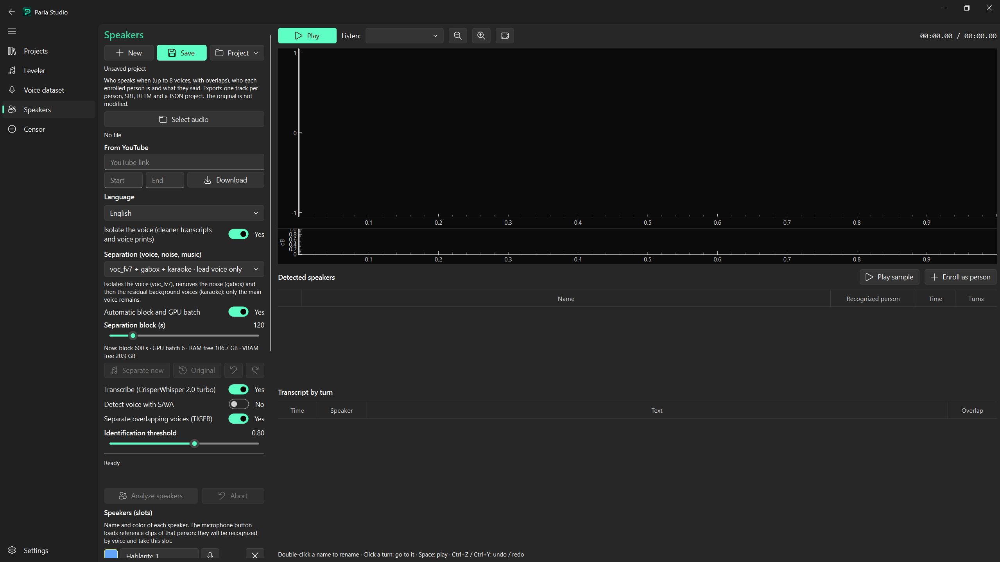
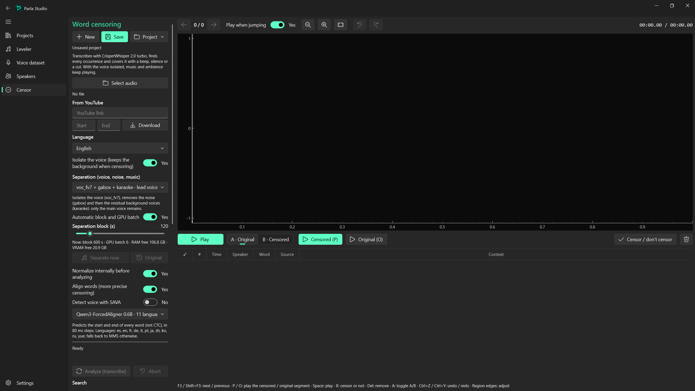
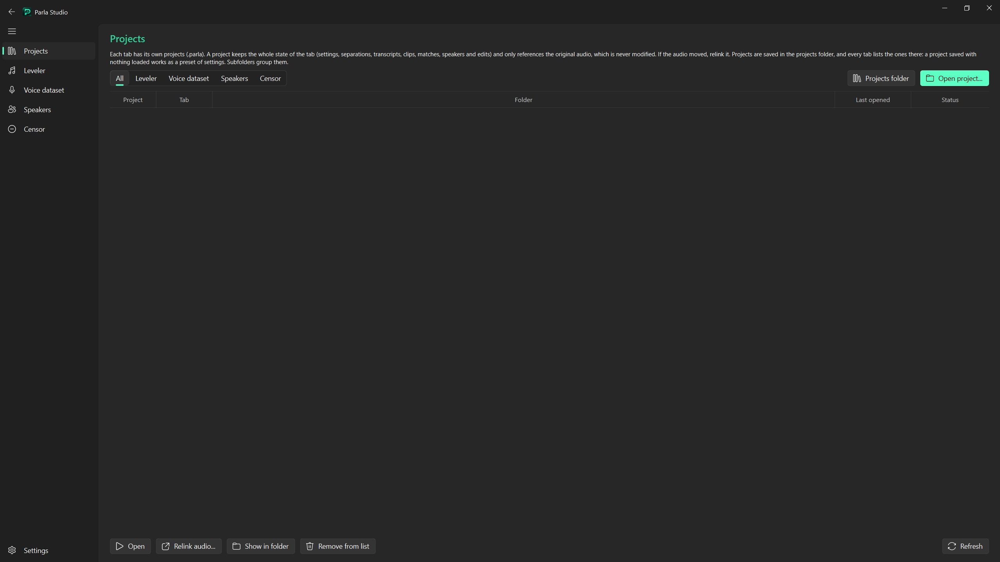

<div align="center">



# Parla Studio

**AI-assisted dialogue toolkit for Windows: level voices, build TTS datasets, identify speakers and censor words, all locally on your GPU.**


</div>

---

Parla Studio is a desktop app that brings together state-of-the-art speech models behind one dark Fluent interface:

- voice separation (Mel-Band RoFormer, voice-isolator)
- voice activity detection (SAVA)
- verbatim transcription (CrisperWhisper 2.0)
- forced alignment (Qwen3-ForcedAligner, MMS, wav2vec2)
- diarization (Nemotron 3)
- overlap separation (TIGER)

All processing runs **offline on your machine** (only model downloads and the optional YouTube fetch use the internet). Python, packages and models all live inside the app folder: no global installs and no cache in your user profile.

## Contents

- [Parla Studio](#parla-studio)
  - [Contents](#contents)
  - [Features](#features)
  - [Requirements](#requirements)
  - [Installation](#installation)
  - [Quick start](#quick-start)
  - [The tabs in detail](#the-tabs-in-detail)
    - [🎚️ Leveler](#️-leveler)
    - [🎙️ Voice dataset](#️-voice-dataset)
    - [👥 Speakers](#-speakers)
    - [🚫 Censor](#-censor)
  - [Projects](#projects)
  - [Dataset export layouts](#dataset-export-layouts)
  - [Models](#models)
  - [Folder structure](#folder-structure)
  - [Diagnostics and logs](#diagnostics-and-logs)
  - [Performance](#performance)
  - [Development](#development)
  - [Licenses](#licenses)

## Features

| Tab | What it does |
|---|---|
| 🎚️ **Leveler** | Evens out dialogue loudness. In AI mode it levels **only the voice**: gain freezes in pauses, so background noise is never pumped up. RMS or LUFS target and a peak limiter. |
| 🎙️ **Voice dataset** | Turns long recordings into clean TTS training clips. Clips are cut at real pauses, transcribed verbatim and given aligned word edges. Exports a ZIP or a plain folder in the layout of 7 TTS projects, or audio only. |
| 👥 **Speakers** | Who speaks when (up to 8 voices, with overlaps). Recognizes enrolled people by voice print and separates overlapping speech. Exports per-person tracks, SRT, RTTM and a JSON project. |
| 🚫 **Censor** | Finds words or phrases (wildcards, per-language lexicons) and covers them with a beep, silence or a cut. Music and ambience keep playing. |
| 📚 **Projects** | Project manager: every saved project of every tab, with its status. Open, relink moved audio, show in folder, forget. |
| ⚙️ **Settings** | Interface language (English / Español), compute device, VRAM release, model licenses. |

**Available in every audio tab:**

- **From YouTube.** Each tab has its own link field, so every tab can fetch a different video at the same time. Paste a link, optionally set a **Start** / **End** time (e.g. `1:30` – `12:00`) and press **Download**. The best audio stream is fetched with [yt-dlp](https://github.com/yt-dlp/yt-dlp), decoded to a 24-bit WAV at its native sample rate and loaded. In **Voice dataset** you can paste several links or a whole playlist. Files are kept in `data/downloads/`, so a video already downloaded is reused. Any site supported by yt-dlp works too.
- **Separation panel.** Pick a separation engine and press **Separate now**. The result replaces the audio on the waveform, so you can chain passes (e.g. remove music, then noise) before analyzing.
- **Undo / redo.** Buttons in every tab, plus **Ctrl+Z** and **Ctrl+Y** (or **Ctrl+Shift+Z**). They cover clip and match edits (move, resize, include, delete, text) in **Voice dataset** and **Censor**, the separation chain in **Leveler**, and the separation chain and speaker renames in **Speakers**. Text fields keep their own Ctrl+Z.
- **Export formats:** WAV 16/24/32-bit float, FLAC 16/24-bit, OGG Vorbis, MP3 320 kbps.
- **Interactive waveform** with zoom, click-to-seek and draggable regions. **Space** plays from the playhead.
- **Long files are fine.** Separation runs in overlapping blocks with crossfades, with a live ETA. Transcription of long audio (more than ~6 min) goes in ~5 min pieces cut at pauses, so the progress bar moves and the log shows *piece k/n* with the remaining time.
- **Abort** in every process of every tab (analysis, separation, transcription, export). It stops within seconds and frees VRAM.
- **VRAM-aware.** Each model loads when a process needs it, and **every model is unloaded when the process ends** (done, failed or aborted), so switching tabs or tasks always starts with free VRAM. If VRAM runs short while loading, the other models are unloaded first. VRAM never spills into system RAM.
- **Automatic memory management.** When a process starts, the app measures the RAM and VRAM that are free at that moment (other programs included) and sizes its work to this machine:
  - **separation block**: the longest block (30–600 s) the free RAM allows; voice-isolator is also limited by VRAM;
  - **RoFormer GPU batch**: how many model chunks run at once on the GPU (1–8) with the free VRAM; the output is the same as with batch 1, it only uses a big GPU better;
  - **SAVA window**: the longest window (1–60 min) that fits in the free VRAM, never longer than the audio.

  The log shows what was chosen (`Automatic memory · RAM free … · VRAM free … · block … · GPU batch …`), and the separation panel shows the current estimate. If something still does not fit, the batch, the block or the window halves itself and the step goes on. **Automatic block and GPU batch** (separation panel) and **Automatic SAVA window** (Leveler) can be turned off to set them by hand. Transcription (CrisperWhisper) and alignment work in fixed ~30 s windows set by the models themselves: bigger windows would not make them faster, so they are not resized.
- **Finish chime.** A short sound when a process ends: rising for done, falling for an error, a single note when aborted. Turn it off in *Settings → Sound when a task finishes*.
- **Log console.** `2- Start.bat` opens a console window next to the app that shows the log of **every** tab (the Leveler also shows it in its panel), colored by level. Everything also goes to `data/app.log`.
- **Fits any screen.** Every tab scrolls when the window is smaller than it needs, instead of squeezing texts and buttons. Minimizing, maximizing or restoring always keeps the window inside the screen.

## Requirements

- **Windows 10 or 11** (64-bit)
- **NVIDIA GPU** with a recent driver supporting **CUDA 13** (R580 or newer). Developed and tested on an RTX 3090 (24 GB).
  Without a CUDA GPU the app still starts and runs on the CPU, but it is very slow.
- **Internet**, only for the installation, the first download of each model and YouTube downloads.

| Resource | Minimum | Recommended | Notes |
|---|---|---|---|
| **VRAM** | 6 GB | 12 GB or more | One model runs at a time and is unloaded when the process ends. Approximate use: CrisperWhisper 2.0 turbo ~3 GB, Mel-Band RoFormer ~2–4 GB at batch 1 (the automatic GPU batch uses more when it is free), voice-isolator ~2 GB, Qwen3-ForcedAligner ~2 GB, Nemotron diarization ~1 GB. Blocks, batches and windows adapt to the free VRAM by themselves. |
| **RAM** | 16 GB | 32 GB (64 GB for audio over 3 h) | Audio is kept in memory as 32-bit float: one hour of 48 kHz stereo takes ~1.4 GB per copy, and a tab holds several (original, separated, processed, preview). A 4 h file needs ~6 GB per copy. |
| **Disk** | 25 GB | 40 GB, SSD | ~4.5 GB for the private environment (`.venv`, `.runtime`), ~13 GB for every model in `models/` (they download only when first used), plus room for downloads, projects and exports. A 1 h 24-bit WAV takes ~1 GB; a `.parla` project is small, but its `.parla-media` folder with separated audio takes about the same as that audio. |
| **Screen** | 1024 × 640 | 1280 × 720 or larger | Below the recommended size the tabs scroll. |

## Installation

1. Download or clone this repository into a folder **without special permissions** (e.g. `D:\Apps\ParlaStudio`):

   ```bash
   git clone https://github.com/mixomo/parla-studio.git
   ```

2. Double-click **`1- Install.bat`**. It:
   - uses [uv](https://github.com/astral-sh/uv) from your PATH, or installs a private copy in `.runtime\uv`;
   - installs a private Python 3.12 in `.runtime\python`;
   - creates `.venv` with PyTorch (CUDA 13.0) and every dependency, pinned by `uv.lock`;
   - disables uv's cache, so nothing is written outside the folder.

   Run it again at any time to repair or update the environment.

3. Double-click **`2- Start.bat`** to open the app. A console window titled *Parla Studio - console* opens with it and shows the log of every tab; closing it closes the app. The app has its own icon on the taskbar.

> [!NOTE]
> The first time you use a feature, its model downloads into `models\`: SAVA, CrisperWhisper, the RoFormers, the aligner, and so on. Progress shows in the log panel. Later runs are fully offline.

To uninstall, delete the folder.

## Quick start

1. **Leveler tab** → *Select audio* (or paste a YouTube link and press *Download*) → *Process* → choose an output folder.
2. To level only the voice of a noisy recording, keep **Mode: AI-assisted** with **Isolate the voice** on.
3. Compare **A · Original** and **B · Leveled** with the **A** key, then export in the format you want.

The interface starts in **English**. Switch to **Español** in *Settings → Interface language*; the app restarts to apply it.

## The tabs in detail

### 🎚️ Leveler

<p align="center"></p>

There are two modes.

**Classic** levels the whole signal with a windowed RMS/LUFS follower:

- attack, release and window are adjustable;
- a 1 ms peak limiter catches overshoots;
- it gives the same values as the reference implementation.

**AI-assisted** levels the voice only:

1. The voice is separated from the background with any engine below.
2. [SAVA](https://github.com/inworld-ai/sava) marks where there is speech, frame by frame (40 ms).
3. Only voice frames are leveled; in pauses the gain is frozen.
4. The final level is measured on the voice alone (dialogue loudness).
5. The background keeps its original level. You can offset it in dB or remove it.

Without separation, SAVA works on the original and the pause offset becomes a noise gate. **Detect voice with SAVA** can be turned off: speech is then found from the energy of the voice (good on a clean separated voice, no extra model or VRAM; rougher on the original with background noise). **Remove** fades pauses to silence without any separation model.

Optional extras:

- save the voice and background stems;
- **One separation area**, as in the other tabs: the **Isolate the voice** toggle (AI mode) and, under it, the only engine list. The AI mode separates with that engine; **Separate now** runs it right away to chain passes (e.g. music, then noise) before leveling, with undo / redo of the chain.

**Separation engines:**

| Engine | Voice + music | Voice + noise | Time per 30 s |
|---|---|---|---|
| voice-isolator (Inworld) | 23.4 dB | 10.8 dB | 4.3 s |
| becruily deux | 30.5 dB | 12.8 dB | 0.8 s |
| voc_fv7 (Gabox) | 30.2 dB | 12.9 dB | 0.8 s |
| gabox denoise-debleed | doesn't remove music | 13.0 dB | 0.5 s |
| voc_fv7 + gabox | 30.1 dB | 12.9 dB | 1.4 s |
| becruily + gabox | — | — | 1.3 s |
| becruily karaoke | lead voice only | — | ~0.8 s |
| karaoke + gabox | lead voice only | — | ~1.3 s |
| **voc_fv7 + gabox + karaoke** *(default)* | lead voice only | — | ~2.2 s |

[becruily's BS-RoFormer karaoke](https://huggingface.co/becruily/bs-roformer-karaoke) removes the residual background voices (backing vocals, people talking behind) and keeps only the main voice. It is offered alone, as **karaoke + gabox** (lead voice, then noise removal) and as **voc_fv7 + gabox + karaoke** (a third pass after the voice is isolated and cleaned), in the separation list of every tab. Its checkpoint (~195 MB) downloads on first use; the karaoke times are estimates, not measured yet.

SI-SDR against the clean voice, measured on an RTX 3090. The RoFormer models run with [pymss](https://github.com/pymss-project/pymss).

### 🎙️ Voice dataset

<p align="center"></p>

Add one or more recordings and press **Analyze and cut**. For each file the pipeline:

1. **Normalizes** internally to −20 LUFS (peak −1 dB), so thresholds behave the same on quiet and loud sources.
2. Optionally **diarizes** (Nemotron 3) and cuts at every turn change, so clips never mix two voices.
3. Optionally **isolates the voice** with the selected engine. The engine can also run on its own from the separation panel.
4. **Transcribes verbatim** with CrisperWhisper 2.0 turbo, with word timestamps and confidences, and drops hallucinated words beyond the end of the audio.
5. **Aligns every word** against the audio with a forced aligner. This fixes the classic problem of clips that clip final syllables or a plural "s".
6. **Detects pauses** with SAVA plus energy analysis, and follows word tails into the pause before cutting. When music or noise stays under the voice and that analysis finds almost no clean silence, the pauses between the word timestamps are used instead (the log says so), so the audio is never chopped word by word. **Detect pauses with SAVA** is off by default; turn it on for clean recordings where the real silences matter. Off: pauses then come straight from the word timestamps (and the *little voice* check is skipped).

Clips fall between the minimum and maximum duration. Cuts prefer sentence ends and land at the energy minimum of each silence.

**Editing clips:** drag a clip on the waveform to move it or pull its edges, double-click the text to correct it, **X** (or **Include / exclude**) includes / excludes the selected clips (with several selected: if any is excluded, all are included; otherwise all are excluded), **Include all** brings back every excluded clip and **Del** deletes the selected clips. **New clip** adds one at the playhead. Select several clips with **Ctrl+click** or **Shift+click** and press **Merge clips** (**Ctrl+M**) to join them into one: from the first start to the last end, with the transcript of the whole span (texts corrected by hand are joined in order). Clips lying between them are absorbed. Undo with Ctrl+Z. Selected clips are marked on the waveform with white edges; Ctrl+click or Shift+click a region on the waveform adds it to the selection or takes it out. **Split at playhead** (**S**) cuts the clip under the playhead in two, each with its own words (a hand-corrected text is split at the same word). **Autoplay clips**, above the clip list, plays a clip as soon as it is selected; it never fires while building a multiple selection.

**Forced aligners:**

| Aligner | Languages | Median edge error\* | Final "s" cut\* |
|---|---|---|---|
| CrisperWhisper alone | — | 80 ms | 82 % |
| MMS-300m (1130 languages, uroman) | any | 87 ms | 79 % |
| wav2vec2 XLSR-53 per language | es, en, fr, de, it, pt, nl, pl, ja, zh, ru | 92 ms | 84 % |
| **Qwen3-ForcedAligner 0.6B** *(default)* | es, en, fr, de, it, pt, ja, zh, ko, ru, yue | **30 ms** | **1.6 %** |

\*Measured on 391 pre-pause words of a Spanish podcast. Languages without a dedicated model fall back to MMS.

**Reviewing clips:**

- Clips appear as regions on the waveform. Drag a clip to move it, or drag its edges to adjust in and out; audio, text and checks are rebuilt when you release.
- Selecting a row **plays the clip**. **Space** plays from the playhead anywhere.
- The full transcript of the selected clip is shown and editable.
- Clips are flagged with a **reason** (too short or long, low confidence, little voice, weak words from echo or a background voice, overlapping voices). They stay excluded until you include them.
- You can add or delete clips by hand, and filter by speaker.
- Options: keep fillers like `[UM]` `[UH]` (off by default), mitigate hallucinations, output sample rate, evaluation split.

### 👥 Speakers

<p align="center"></p>

- **Diarization** with [Nemotron 3 Diarization](https://huggingface.co/nvidia/Nemotron-3-Diarization): up to 8 voices, overlaps included. It runs on the original audio, before isolation.
- **Voice prints** (WavLM) recognize enrolled people. If similarity is under the threshold, the speaker stays as "Speaker N": no invented identities.
- **Enrollment.** Give a name and 3 to 5 clean clips of 5 s or more. Each clip is isolated and diarized, and clips that don't match the rest are discarded with a report. You can also enroll a detected speaker straight from the table.
- **Slots.** Four to start, up to 8. Each slot has a name, a color and a microphone button to load reference clips. Detection is either *automatic* (adds slots when more voices appear) or *limited to the slots* (extra voices merge into the most similar one).
- **Detect voice with SAVA** (off by default). Speaker activity where SAVA hears no voice (music, noise, effects) is removed, so turns, voice prints and per-person tracks stay clean; words transcribed where nobody speaks are dropped.
- **Overlapping voices (TIGER).** Every overlapped segment is separated with [TIGER](https://huggingface.co/JusperLee/TIGER-speech). Each voice is matched to its speaker and transcribed on its own, so both overlapping sentences appear whole, each with its name.
- **Project export:**
  - `original/`, an untouched copy;
  - `processed/isolated/` and `processed/separated/`;
  - `speakers/`, one track per person;
  - `transcripts/`, with SRT, JSON and RTTM;
  - `project.json`, with times, text, speaker, identity, confidence, overlap and the source of each segment.

### 🚫 Censor

<p align="center"></p>

- **Search.** Analyze once, then search words or phrases. Matching ignores accents and case, `*` is a wildcard, and whole-word matching is optional.
- **Jump between matches** with **F3 / Shift+F3**. **P / O** preview the censored or original segment, **X** toggles whether a match is censored, **Del** removes it from the list, and each match is an editable region on the waveform.
- **Modes:**
  - **beep** or **silence** replace only the isolated voice, so the background keeps playing;
  - **cut** removes the whole segment with a crossfade.

  Beep tone, beep level and the margin around each word are adjustable.
- **Word alignment** (on by default). The isolated voice is normalized again before transcribing and aligning (as in Voice dataset). Each censor region covers **both** time estimates, CrisperWhisper's and the aligner's (each side at most 150 ms further), so no part of the word stays audible when they disagree; then it is trimmed to the voice energy, padded by *Margin* and snapped to the nearest energy dip. Aligner results that collapse a word to almost nothing are discarded.
- **Detect voice with SAVA** (off by default). Words transcribed where SAVA hears no voice at all (Whisper hallucinations over music or silence) are dropped before aligning, and the speakers are marked only where there is voice. The log lists every dropped word.
- **Preventive censoring** (off by default: no lexicon ships with the app). Turn on **Automatically censor what is in the lexicon** and, as soon as there is a transcript, anything in the language's lexicon is censored automatically. A lexicon combines:
  - your own editable list, `data/lexicons/custom_<lang>.txt`;
  - sources downloaded on demand:

    | Source | Languages | License |
    |---|---|---|
    | [TextDetox](https://huggingface.co/datasets/textdetox/multilingual_toxic_lexicon) | es, en, de, fr, it, zh, ja | OpenRAIL++ |
    | [LDNOOBW](https://github.com/LDNOOBW/List-of-Dirty-Naughty-Obscene-and-Otherwise-Bad-Words) | es, en, de, fr, it, pt, nl, pl, ja, zh | CC-BY-4.0 |
    | [dsojevic](https://github.com/dsojevic/profanity-list) | en | MIT |

- **List syntax:**

  | Line | Meaning |
  |---|---|
  | `word` | exact match |
  | `put*` | starts with |
  | `*word*` | contains |
  | `*ón` | ends with |
  | `multi word phrase` | phrase |
  | `!word` | exception, never censored |

  Common obfuscations are neutralized: `p.u.t.a`, `m1erd4`, `wooord`. The letter **ñ** is significant (coño ≠ cono). Japanese and Chinese match by substring.
- **List import.** Old lists can be imported and cleaned: the importer restores ñ, removes duplicates and folds variant families into wildcards.
- **Censor only…** limits censoring to one speaker (diarization).

## Projects

<p align="center"></p>

Parla Studio is a **non-destructive editor**: your audio files are only read, never modified. Each tab saves its own,
independent project (`.parla`) from the buttons under the tab title: **New**, **Save** and the **Project** menu.

| Action | Where | Shortcut |
|---|---|---|
| New project (clears the tab, asks first) | **New** button · Project menu | |
| Save project | **Save** button · Project menu | **Ctrl+S** |
| Save project as... | Project menu | **Ctrl+Shift+S** |
| Open project... | Project menu | **Ctrl+O** |
| Projects of the tab in the `projects/` folder | Project menu → **Projects folder** | |
| Recent projects of the tab (saved elsewhere) | Project menu → **Recent** | |

**The `projects/` folder** at the root of Parla Studio has one subfolder per tab: `projects/leveler`, `projects/dataset`, `projects/speakers` and `projects/censor`. Projects are saved by default in the subfolder of their tab, and every tab's **Project** menu lists the projects of **that tab only**, newest first; subfolders inside group them (`projects/leveler/presets/soft voice` shows as `presets/soft voice`). A project dropped anywhere else in `projects/` is moved into its tab's subfolder (with its media folder) when the app starts. A project saved with nothing loaded keeps only the settings, so it works as a **preset**: open it in its tab to bring those settings back. The **Projects** page lists the folder and the recent projects of every tab; **Remove from list** forgets a recent project saved elsewhere, and sends a project of the `projects/` folder (with its media folder) to the Recycle Bin after asking, so it can be restored.

A project keeps **the whole state of the tab**: every setting, the separation chain, transcripts and word timings,
diarization, speakers and their names, TIGER separations, clips with their edges and corrected texts, matches and
whether each one is censored, and the last leveling result. Opening it brings the tab back exactly as it was, without
running any model again.

- **Light and referential.** A `.parla` file is a small ZIP with `project.json` (the state) and the small numeric analysis: usually a few hundred KB to a few MB, even for hours of audio. The original audio is only referenced, by its absolute path and by its path relative to the project, so a folder with the project and its audio can be moved or copied as a whole.
- **Derived audio** (separated voice, leveling result...) is not inside the project: it goes next to it, in the folder `<name>.parla-media/`, as 24-bit FLAC. Saving again only writes what changed and removes what is no longer used. Move or copy it together with the project. If you delete it, the project still opens and only asks you to generate that audio again (separate / process); transcripts, edits and matches are kept.
- **Relink.** If an audio file is not where it was (nor next to the project), a dialog lists the missing files. Locate one and the others are looked for in the same folder, or search a whole folder by name. Every reference inside the project follows the new location. From the **Projects** page you can also relink a project without opening it.
- **Safe.** Saving is atomic (a failed save never breaks the previous file). Loading never runs code from the file: only plain data, numpy arrays and the app's own data types are accepted.
- Different tabs can have different projects open at the same time.

## Dataset export layouts

Choose the output under **Output**: a single **ZIP file**, or a **folder (uncompressed)**, created as a new `dataset` subfolder of the location you pick. Either way you get the clips in your chosen audio format, the metadata files, an evaluation split and a license note (except **Audio only**, which contains just the clips).

| Layout | Contents | For |
|---|---|---|
| **LJSpeech (generic)** | `wavs/` + `metadata.csv` (`clip\|text`) + `metadata_speakers.csv` | most trainers |
| **Audio + .txt** | every clip with its `.txt` at the root | FireRedTTS3, MOSS-TTS, Higgs, IndexTTS, CosyVoice3, Qwen and OmniVoice |
| **Audio only** | just the clips, no transcripts or metadata | voice-cloning references, listening, other tools |
| **Fish Speech / S2** | one folder per speaker with `clip.wav` + `clip.lab` | fish-speech |
| **Qwen3-TTS SFT** | `train_raw.jsonl` / `eval_raw.jsonl` (audio, text, ref_audio) | Qwen3-TTS fine-tuning |
| **VoxCPM** | `train.jsonl` / `val.jsonl` (audio, text, duration) | VoxCPM |
| **XTTS-v2 / Coqui** | `metadata_train.csv` + `metadata_eval.csv` + `lang.txt` | Coqui XTTS-v2 |
| **Official CosyVoice (Kaldi)** | `wav.scp`, `text`, `utt2spk`, `spk2utt` | CosyVoice recipes |

Every layout also includes `metadata.jsonl` with times, speaker, confidence and source file for each clip.

## Models

All models are downloaded from Hugging Face into `models/` the first time they are needed.

| Model | Used for | License |
|---|---|---|
| [SAVA](https://github.com/inworld-ai/sava) (Inworld AI) | voice activity detection | Apache-2.0 |
| [voice-isolator](https://github.com/inworld-ai/voice-isolator) (Inworld AI) | voice / background separation | Apache-2.0 |
| [becruily deux](https://huggingface.co/becruily/mel-band-roformer-deux) | voice / music separation | CC-BY-NC-4.0 |
| [Gabox voc_fv7, denoise-debleed](https://huggingface.co/GaboxR67/MelBandRoformers) | voice isolation, noise and bleed removal | see the model card |
| [becruily BS-RoFormer karaoke](https://huggingface.co/becruily/bs-roformer-karaoke) | lead voice / background voices | no license stated in the repo |
| [CrisperWhisper 2.0 turbo](https://github.com/nyrahealth/CrisperWhisper) (nyra health) | verbatim transcription with word timestamps | **non-commercial** research license |
| [Qwen3-ForcedAligner 0.6B](https://huggingface.co/Qwen/Qwen3-ForcedAligner-0.6B-hf) | forced alignment | Apache-2.0 |
| [MMS-300m forced aligner](https://huggingface.co/MahmoudAshraf/mms-300m-1130-forced-aligner) | forced alignment (any language) | CC-BY-NC-4.0 (MMS) |
| [wav2vec2 XLSR-53](https://huggingface.co/jonatasgrosman) per language | forced alignment | Apache-2.0 |
| [Nemotron 3 Diarization](https://huggingface.co/nvidia/Nemotron-3-Diarization) (NVIDIA) | who speaks when | OpenMDW-1.1 |
| [WavLM base plus SV](https://huggingface.co/microsoft/wavlm-base-plus-sv) (Microsoft) | voice prints | see the model card |
| [TIGER](https://huggingface.co/JusperLee/TIGER-speech) | overlapping speech separation | code MIT (vendored), weights Apache-2.0 |

## Folder structure

```text
parla-studio/
├─ 1- Install.bat          # creates the private environment (uv, Python 3.12, PyTorch CUDA)
├─ 2- Start.bat            # launches the app with its log console
├─ assets/                 # logo.png (source of the icon) and README screenshots of each tab
├─ pyproject.toml / uv.lock
├─ src/parla_studio/
│  ├─ __main__.py          # entry point: python -m parla_studio [audio | project.parla]
│  ├─ paths.py             # every app folder in one place
│  ├─ i18n.py, i18n_es.py  # interface language (English source, Spanish translation)
│  ├─ settings.py          # user preferences (data/settings.json)
│  ├─ assets/              # app icon (PNG + ICO, made from assets/logo.png)
│  ├─ core/                # audio and AI pipeline, no Qt
│  │  ├─ leveler.py, smart.py       # classic and voice-aware leveling
│  │  ├─ models.py, blocks.py       # model loading, separation engines, block processing
│  │  ├─ aligner.py                 # Qwen3 / MMS / wav2vec2 forced alignment
│  │  ├─ dataset.py                 # clip detection and dataset export
│  │  ├─ speakers.py                # diarization, voice prints, slots, project export
│  │  ├─ censor.py, profanity.py    # search, lexicons, censoring
│  │  ├─ audio_io.py                # loading and multi-format export
│  │  ├─ fetch.py                   # audio from YouTube / online videos (yt-dlp + PyAV)
│  │  ├─ project.py                 # .parla projects: safe serialization, relinking
│  │  └─ mss_configs/               # RoFormer configs (weights download on demand)
│  ├─ ui/                  # PySide6 + Fluent widgets, one module per tab
│  └─ vendor/tiger/        # TIGER model code (MIT)
├─ tests/                  # pytest suite + manual GUI / model checks
├─ data/                   # created at runtime (git-ignored)
│  ├─ settings.json        # interface language, finish chime on/off
│  ├─ sounds/              # finish chimes (generated on first use)
│  ├─ app.log              # session log
│  ├─ logs/                # per-file transcription / alignment logs
│  ├─ lexicons/            # censor lists and downloaded sources
│  ├─ downloads/           # audio fetched from YouTube (WAV)
│  ├─ projects.json        # recent projects (Projects page)
│  ├─ profiles.json        # enrolled voice prints
│  └─ slots.json           # speaker slots
├─ projects/               # .parla projects and presets, one subfolder per tab (leveler, dataset, speakers, censor)
├─ models/                 # downloaded weights (git-ignored)
├─ .venv/  .runtime/  .tmp/  # private environment (git-ignored)
```

## Diagnostics and logs

- **The console** opened by `2- Start.bat` shows the log of every tab live (warnings in yellow, errors in red).
- **`data/app.log`** keeps everything shown in the log panel and the console, plus full tracebacks.
- **`data/logs/`** holds one log per analyzed file:
  - the **verbatim CrisperWhisper output**: every word with its start, end, confidence and tags;
  - what the **forced aligner corrected** (Δ start / Δ end per word, unaligned or suspicious words);
  - the final **clip table**, with how far each clip extends after its last word.

  Use it to check edge precision against the audio.

## Performance

Measured on an RTX 3090, per minute of audio:

| Step | Time |
|---|---|
| Mel-Band RoFormer (voc_fv7 + gabox) | ~3 s |
| voice-isolator | ~9 s |
| SAVA | < 1 s |
| CrisperWhisper 2.0 turbo | ~6 s (~11 s with hallucination mitigation) |
| Qwen3-ForcedAligner | ~4 s |
| Nemotron 3 Diarization | ~0.15 s |

## Development

```bash
.venv\Scripts\python -I -m pytest -q tests
```

```bash
.venv\Scripts\python -I -m parla_studio path\to\audio.wav
```

- `tests/test_core.py` holds the unit tests. Tests that need the reference recording are skipped when it is not present.
- `tests/ui_smoke.py` and `tests/manual/` drive the full GUI and real models. They need your own audio files; see each script's docstring.
- The source code, comments and tests are in English. Interface strings are written in English and translated at runtime by `i18n.py`: to add a language, add a dictionary like `i18n_es.py` (English text → translation), register it in `LANGUAGES` and load it in `_build()`.

## Licenses

Parla Studio is released under the **[GNU General Public License v3.0](LICENSE)**. The models it downloads are not part of this repository and keep their own licenses:

- **CrisperWhisper 2.0:** the code is MIT, but **the weights and the transcripts they produce are under the nyra health Non-Commercial Research License**. Datasets created with this app are for **non-commercial use only** and may not be used to train commercial models without a license from nyra health. Every exported dataset includes a license note.
- **becruily deux** and **MMS** are CC-BY-NC-4.0 (non-commercial).
- **TIGER:** code MIT (included in `vendor/tiger` with its LICENSE), weights Apache-2.0.
- **PySide6-Fluent-Widgets** is GPL-3.0, the same license as this app.
- Each model keeps its own license (see [Models](#models)). Check them before any commercial use.
- **yt-dlp** (Unlicense) and **Deno** (MIT, the JavaScript runtime yt-dlp needs for YouTube) are installed as packages. Only download content you have the rights to use, and respect the terms of each site.
